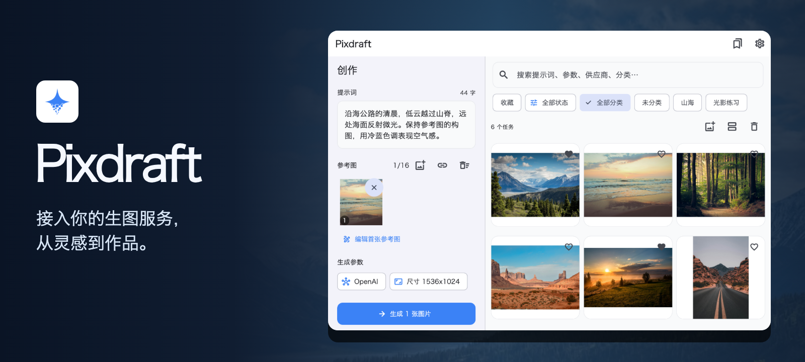
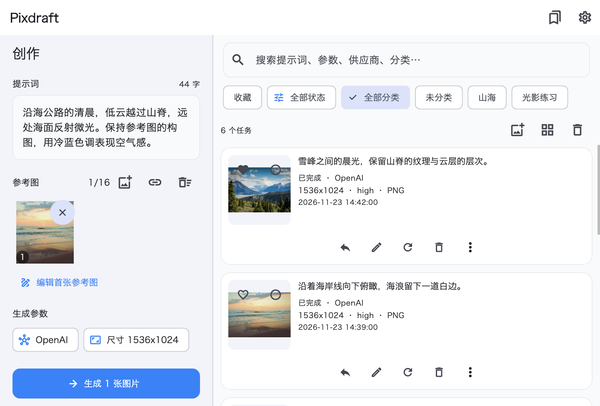
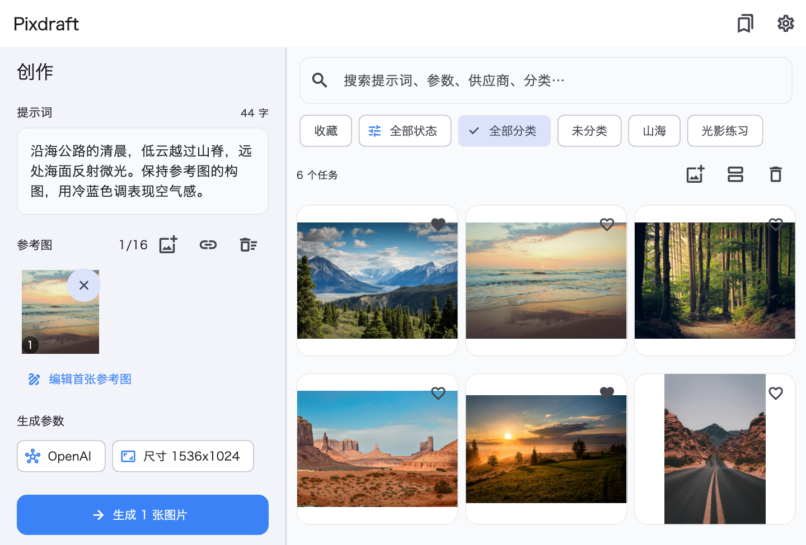
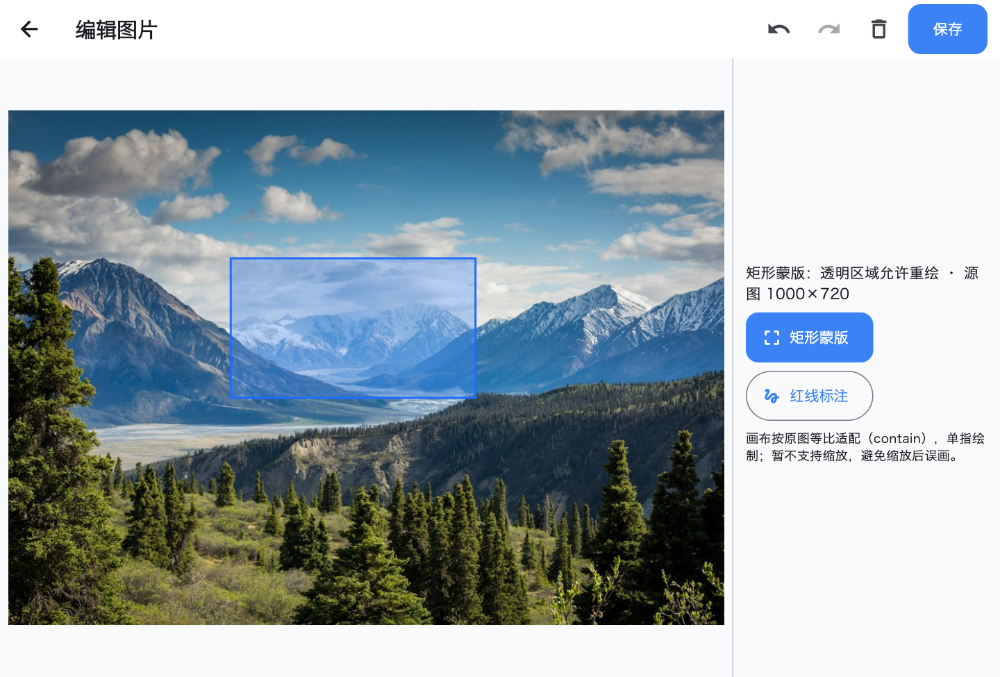
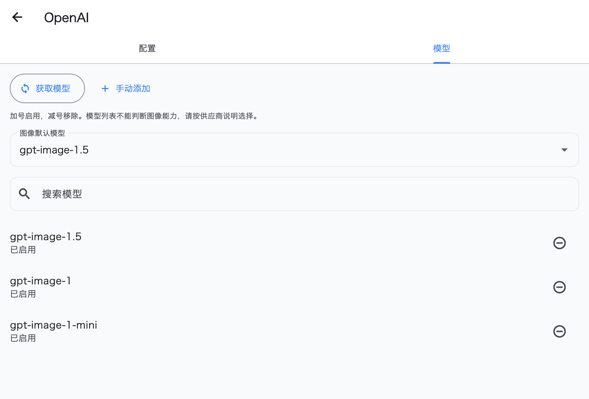

# Pixdraft



接入自己的生图服务，用提示词或参考图生成图片。

Flutter 构建，作品保存在本机或当前浏览器。

## 下载

[GitHub Releases](https://github.com/HakimYu/Pixdraft/releases/latest) 提供 Android APK、macOS 通用 DMG 和 Ubuntu 24.04 x86_64 DEB。

## 界面演示

| 创作面板 | 作品图库 |
| --- | --- |
|  |  |
| **局部编辑** | **模型管理** |
|  |  |

截图中的风景照片用于演示，来自 [Unsplash](https://unsplash.com/license)。

## 开始创作

打开「设置 → 供应商与模型」，填写服务地址和 API Key，再到该供应商的「管理 → 模型」启用或添加模型。

选好模型、写下提示词，再按需添加参考图、局部蒙版或红线标注。

提交后在图库查看进度和结果。可以收藏、分类、导出作品，也可以复用旧任务，或把常用提示词存进提示词库。

生成时，提示词和参考图会发送给你配置的供应商。清除浏览器站点数据或更换设备前，请先在「设置 → 备份与恢复」导出备份。

支持 OpenAI 兼容的 Images 和 Responses 协议，以及 WaveSpeed、EvoLink。流式预览、参考图、蒙版和其他参数取决于所选模型与协议。WaveSpeed 和 EvoLink 最多接受 10 张参考图，不支持蒙版、红线标注和流式预览。WaveSpeed 的默认编辑模型需要参考图；EvoLink 会先将参考图上传到其文件服务，文件 72 小时后过期。

## 插件

第三方插件仅在原生端可用。

[从示例插件开始](examples/plugins/example-stamp/README.md) · [插件开发指南](docs/plugins.md)

## 从源码构建

使用 Flutter 3.47.5 / Dart 3.13.4。在项目根目录安装依赖并检查：

```sh
flutter pub get
dart analyze lib test
flutter test
```

| 目标 | 构建命令 | 注意事项 |
| --- | --- | --- |
| Android | `flutter build apk --release --split-per-abi` | APK 输出到 `build/app/outputs/flutter-apk/`。正式发布需配置 `../pixdraft-signing/` 中的 Android 发布签名。 |
| iOS / iPadOS | `flutter build ios --release --no-codesign` | 真机安装另需签名。 |
| macOS | `flutter build macos --release` | 发布需配置签名。 |
| Windows | `flutter build windows --release` | 需要 Visual Studio C++ 桌面工具链。 |
| Linux | `flutter build linux --release` | 需要 GTK 和 libsecret 开发包；运行时需要可用的 Secret Service。 |
| Web | `flutter build web --release --no-wasm-dry-run` | 部署整个 `build/web/`，详见 [Web 部署与存储](web/SQLITE.md)。 |

## 应用更新

在原生应用中打开「设置 → 应用更新」可手动检查 GitHub Releases、关闭自动检查或指定镜像。自动模式优先使用 GitHub 与内置镜像，内置候选均不可用时才读取 Akams 节点名单。安装包通过发布签名清单校验后可交给系统打开。

签名清单和安装包的发布步骤见 [发布 Pixdraft 更新](tool/UPDATE.md)。

## 许可证

Pixdraft 自有部分采用 [PolyForm Noncommercial 1.0.0](LICENSE)，可按许可条款用于非商业用途，并修改和分发。

## 第三方来源与许可

本应用的创作和图库流程参考 [GPT Image Playground](https://github.com/insistanan/GPT_Image_Playground)，并兼容导入其 v6–v9 ZIP 备份。